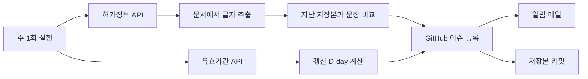

# 의약품 허가사항 변경 모니터링 도구

식약처 공개 API로 관심 품목의 허가문서를 매주 확인해 **바뀐 문장**과 **품목 갱신 신청 기한**을 GitHub 이슈와 알림 메일로 받는 파이썬 도구입니다.

약사로서 RA(Regulatory Affairs) 업무의 반복 확인 작업을 자동화해 보려고 만든 포트폴리오 프로젝트입니다.

## 해결하려는 문제

허가사항은 효능효과, 용법용량, 사용상 주의사항 문서로 구성되고, 안전성 정보나 회사의 변경으로 수시로 개정됩니다. 특히 다른 회사 품목의 변경은 직접 통보되지 않으므로, 담당자가 긴 문서를 찾아 다시 읽어야 알 수 있습니다.

이 도구는 그중 **변경이 있었는지 찾아내고 바뀐 문장을 추려내는 단계**를 맡습니다. 변경의 의미와 자사 품목에 미치는 영향은 사람이 판단합니다.

## 동작 방식



## 결과 예시

실제 실행 결과의 일부입니다.

```text
[허가 모니터링] 변경 0건 / 갱신 임박 2건

[첫 저장] 글루코파지정500밀리그램(메트포르민염산염) (200401015)
  [갱신 임박] 신청 기한: 2026-12-30 (D-60) / 유효기간: 2027-06-30
[변경 없음] 넥시움정40밀리그램(에스오메프라졸마그네슘) (200009026)
  [갱신] 신청 기한: 2029-09-30 (D-1065) / 유효기간: 2030-03-31
```

변경이 있으면 아래 형식으로 표시됩니다. 내용은 형식을 보여주기 위한 가짜 문구입니다.

```text
[변경 있음] 시험약 (000000000)
  허가정보 변경일: 20260101
  최근 변경 사유: 사용상주의사항변경(부작용포함)
  <사용상 주의사항>
  [추가] 임신부에게 투여하지 않는다.
  [변경] 1일 최대 10 mg을 넘지 않는다.
      -> 1일 최대 20 mg을 넘지 않는다.
```

## 설계에서 고려한 점

| 결정 | 이유 |
|---|---|
| 성분이 아니라 품목기준코드 단위로 모니터링 | 성분 하나에 품목이 수백~천 개 이상이어서, 대표 품목을 골라야 알림을 검토할 수 있습니다 |
| 허가정보의 `VALID_TERM`을 쓰지 않음 | 이 값은 "제조일로부터 36개월" 같은 제품 사용기간이고, 품목 갱신 기한이 아닙니다 |
| 문장 위치 이동을 삭제와 추가로 표시 | "일반적 주의"의 문장이 "경고"로 옮겨지는 것처럼 위치 변화 자체가 중요할 수 있습니다 |
| 표의 빈 칸 위치를 보존 | 이상반응 빈도표에서 어떤 반응이 어느 빈도 칸에 있는지 구분하기 위해서입니다 |
| 문서 제목 속성까지 추출 | 효능효과 내용이 본문이 아니라 제목 속성에만 있는 경우가 있습니다 |
| 비어서 온 문서는 삭제로 알리지 않음 | 일시적인 응답 문제를 전체 삭제로 잘못 알리지 않기 위해서입니다 |
| 이슈 등록 후 저장본 커밋 | 등록에 실패하면 다음 실행에서 같은 변경을 다시 알립니다 |

## 예시 품목

`items.txt`의 10개는 시연을 위해 성분별 대표 품목을 하나씩 고른 **예시**이며, 특정 회사나 제품과 관련이 없습니다. 파일의 품목기준코드만 바꾸면 다른 품목을 모니터링할 수 있습니다. 코드는 [의약품안전나라](https://nedrug.mfds.go.kr)에서 확인할 수 있습니다.

## 한계

- **공식 절차를 대체하지 않습니다.** 공식 근거는 식약처 공문과 안전성 정보이며, 이 도구는 변경을 빨리 알아차리기 위한 보조 도구입니다.
- **대표 품목만 봅니다.** 같은 성분의 다른 품목, 다른 함량, 복합제의 변경은 감지하지 못합니다.
- **등록 전 변경은 비교할 수 없습니다.** 저장본은 품목을 등록한 날부터 쌓입니다.
- **API 반영 이후에만 감지합니다.** 주 1회 실행이라 실제 변경보다 늦을 수 있습니다.
- **`갱신 기한 지남`은 날짜만 본 표시입니다.** 갱신을 이미 신청했을 수 있으며, 미신청을 뜻하지 않습니다. 이슈 제목의 `갱신 임박` 건수에도 포함됩니다.
- **`VALID_TERM_DATE_CUTLINE`의 의미는 추정입니다.** 공식 문서에 항목 설명이 없어, 이름과 날짜를 보고 갱신 신청 기한으로 해석했습니다.
- **표의 병합된 칸은 위치가 밀려 보일 수 있습니다.** 변경은 감지되지만, 해당 칸은 원문 확인이 필요합니다.
- **실제 허가 개정 사례로는 아직 검증하지 못했습니다.** 변경 감지는 자동 시험과 저장본을 일부러 바꾼 시험으로 확인했고, 변경 판단 기준(유사도 60%)은 임시 값입니다.

## 파일 구성

| 파일 | 역할 |
|---|---|
| `main.py` | 실행 파일, 보고서 작성 |
| `fetch_api.py` | 식약처 API 호출 |
| `parse_doc.py` | 허가문서 XML에서 글자 추출 |
| `diff_text.py` | 문장 단위 비교 |
| `snapshot.py` | 저장본 관리 |
| `renewal.py` | 갱신 D-day 계산 |
| `items.txt` | 모니터링 품목 목록 |
| `snapshots/` | 품목별 저장본 |
| `.github/workflows/monitor.yml` | 주간 자동 실행 |

## 직접 실행하기

공공데이터포털에서 [의약품 제품 허가정보](https://www.data.go.kr/data/15095677/openapi.do)와 [의약품 품목 유효기간 정보](https://www.data.go.kr/data/15111775/openapi.do)를 활용신청한 뒤 아래처럼 실행합니다.

```bash
python3 -m venv .venv
source .venv/bin/activate
pip install -r requirements.txt
cp .env.example .env            # .env에 API 키 입력
python main.py                  # 모니터링 실행
python -m unittest              # 자동 시험
```

GitHub에서 자동 실행하려면 저장소 Secrets에 `DATA_GO_KR_API_KEY`를 등록합니다.

## 개발 도구

이 프로젝트는 Claude Code의 도움을 받아 만들었습니다. 요구사항과 허가 업무 관점의 판단은 직접 정하고, 동작은 실제 API로 확인했습니다.
